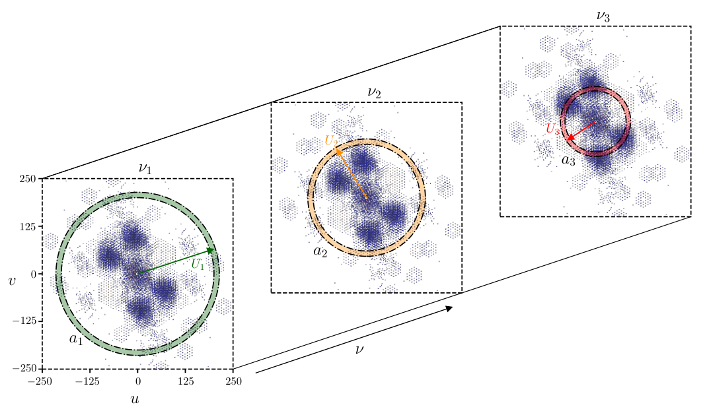
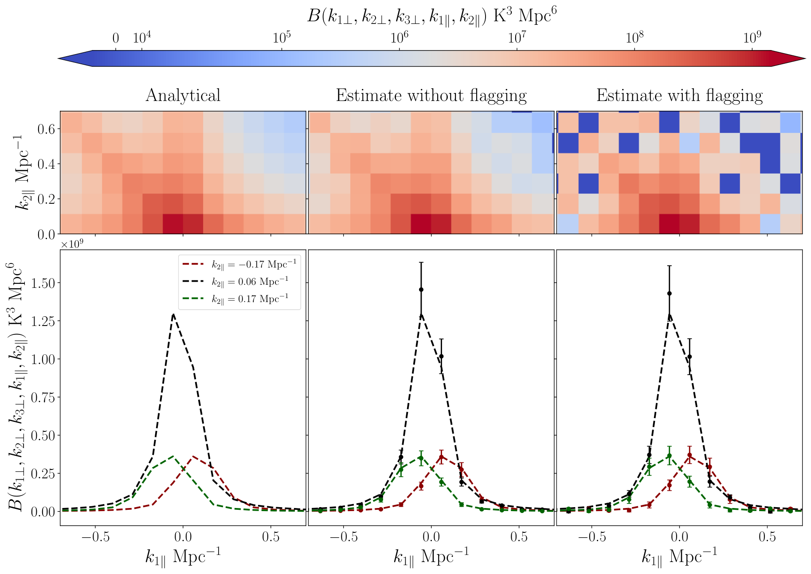

# AMBER
### Visibility-based multi-frequency angular and 3D 21 cm bispectra Estimator for Radio interferometric data

##### It takes gridded visibility data from radio interferometric observations and computes the 3-visibility correlations for all possible triplets of baselines that form a closed triangle. The output is Multifrequency Angular Bspectrum (MABS) and 3D 21-cm Bispectrum.

[Paper](https://arxiv.org/abs/2506.10526) · [Installation](docs/INSTALL.md) · [Code review](docs/REVIEW.md)

AMBER estimates the **multi-frequency angular bispectrum (MABS)** from gridded radio-interferometric visibilities. The C programs perform gridding and FFT-accelerated frequency-triplet correlations; the Python analysis converts frequency-separation statistics into a cylindrical 3D bispectrum and bins triangle configurations. The method is developed for redshifted 21 cm studies and was tested in the paper using simulated MWA visibility sampling, including frequency flagging.

**Build checked:** the selected root Makefile targets compile on Linux/GCC; compiler warnings and runtime issues remain. See [build log](docs/build.log).

**Status:** documented research-code snapshot. Observational inputs are not included. The uploaded C programs contain partial-run starting indices, dataset-specific channel settings and portability issues; notebooks require external data and path edits. This is not a calibrated-data download, a 21 cm detection pipeline, or a turnkey reproduction of every paper figure.


*Figure 1 of arXiv:2506.10526v1: annular bins across frequency planes. [Attribution](docs/figures/ATTRIBUTION.md).*

## Scientific idea

The MABS correlates three angular Fourier modes at three frequencies. Assuming frequency stationarity over the analyzed interval, it can be averaged at fixed separations $\Delta\nu_1=\nu_1-\nu_3$ and $\Delta\nu_2=\nu_2-\nu_3$. Schematically, the conversion is a two-dimensional Fourier transform:

$$B(\mathbf k_1,\mathbf k_2,\mathbf k_3)=r^4(r')^2\int d\Delta\nu_1\,d\Delta\nu_2\,e^{-ir'(k_{1\parallel}\Delta\nu_1+k_{2\parallel}\Delta\nu_2)}B_A(\ell_1,\ell_2,\ell_3,\Delta\nu_1,\Delta\nu_2),$$

with $\mathbf k_{i\perp}=\boldsymbol\ell_i/r=2\pi\mathbf U_i/r$ and $k_{3\parallel}=-k_{1\parallel}-k_{2\parallel}$. Here $r'=dr/d\nu$ in the signed convention; the analysis uses a positive conversion magnitude and its own axis ordering. Match signs, axis permutations, frequency units and FFT normalizations to the chosen reader/transform pair. Finite bandwidth, flagging and windowing affect the measured transform; missing lag cells must not be blindly treated as valid zero measurements.


*Figure 4 of arXiv:2506.10526v1; published results, not newly generated output.*

## Installation

```bash
sudo apt install build-essential libfftw3-dev libgsl-dev libcfitsio-dev python3-venv
# After publication:
git clone https://github.com/sukhdeepsinghgill/AMBER.git
cd AMBER
make
python3 -m venv .venv
source .venv/bin/activate
python -m pip install -r requirements-analysis.txt
```

The root build creates `3_vcg/vcg`, `4_fbe/amber` and `4_fbe/amber_v2`. It deliberately excludes the broken historical `maps` target. C compilation needs FFTW3/OpenMP, GSL and CFITSIO; Python analysis needs NumPy, SciPy and Matplotlib, with pandas/Jupyter for notebooks. See [INSTALL.md](docs/INSTALL.md) for custom library prefixes.

## Data flow

| Stage | Program | Product |
|---|---|---|
| Grid compatible multi-channel UVFITS | `3_vcg/vcg` | Visibility grid with header plus separate sampling grid |
| Accumulate lag-space triple products | `4_fbe/amber` or `amber_v2` | Binary MABS accumulators and normalization/count arrays |
| Normalize, mask/window and transform | `mabs_funcs.py`, `mfunc_winds.py` | MABS and cylindrical 3D bispectrum |
| Bin full Fourier triangles | Python functions/notebooks | 3D bispectrum bins in size and shape |

The two C variants write **different binary formats**. Pick the matching reader; do not interchange output files or combine partial runs without checking their normalization and covered triangle indices.

## Configure and run

First resolve [REVIEW.md](docs/REVIEW.md). Supply compatible multi-channel random-groups UVFITS; the archived script expects `data_vis/1000004080.fits`, which is not included. This reader is not a generic FITS-image or CASA-MS reader.

```bash
# From repository root, after make; supply data_vis/1000004080.fits first.
(
  cd 3_vcg
  mkdir -p output_data
  ./vcg ../data_vis/1000004080.fits inputparameters output_data/GV_data_1 1 0 1 output_data/sampling
)
```

The last four arguments are `flag_key`, `collapse_key`, `write_sampling_key`, `sampling_filename`. `flag_key=1` selects the flag-aware gridding path; `0` selects the unflagged path. `collapse_key=1` combines groups of **four** channels in the current C source; update all downstream frequency/channel settings if enabling it. `write_sampling_key=1` writes the sampling needed by the estimator.

Set the first line of `4_fbe/input_params_ess` to your metadata and gridded-data directory, for example:

```text
154.255e6 40000 385 ../3_vcg/output_data
```

These are frequency in Hz, channel width in Hz, 1-based reference channel, and data path. This relative path assumes execution from `4_fbe/`. Match your UVFITS metadata, including any channel averaging; do not retain the example blindly.

```bash
(
  cd 4_fbe
  mkdir -p results/v1 results/v2
  # For flag_key=1, provide data_path/uf_chans.txt and synchronize uf_nc first.
  ./amber 1
  # Alternative normalization-aware implementation, not a sequential stage:
  # ./amber_v2 1
)
```

`uf_chans.txt` must be placed in `data_path` (for the example, `3_vcg/output_data/`) and must contain the integer channel indices expected by `get_uf_chans`, with count `uf_nc`; these indices are used directly in C and must correspond to the gridded channel numbering. It is not supplied or generated by the packaged launch script. Do not set `flag_key=0` simply to bypass a missing flag list for flagged data.

## Parameters you must synchronize

| Setting | Location | Uploaded setting / meaning |
|---|---|---|
| `nc Umax FWHM f` | `3_vcg/inputparameters` | `768 602 1480.73 1`; channels, wavelengths, arcmin, taper parameter |
| Flagging/collapse/sampling | `vcg` CLI | `1 0 1` in example |
| `n_collapse` | `3_vcg/main.c` | `4` |
| Reference frequency/channel spacing/channel | `4_fbe/input_params_ess` | `154.255e6`, `40000`, `385` |
| `data_path` | Same file | Replace placeholder with actual grid directory |
| `Nbin` / `Nr`, ring edges | `amber*.c`, `amber_funcs.c:annular_rings` | 22 rings, piecewise edges to `U=270` |
| `nc10` | `amber.c`, `amber_v2.c` | `383`; lag side length `2*nc10+1=767` |
| `uf_nc` | Both C entry points | `552`; must equal supplied valid-channel count |
| `Nthreads` | Both C entry points | `omp_get_max_threads()/2 - 2`; unsafe on small machines — correct before run |
| Starting triangle index `rp` | `amber.c` / `amber_v2.c` | `365` / `635`; partial runs, not all triangles |
| Channel/lag constants | `mabs_funcs.py` and duplicate in `analysis_codes/` | Must match selected C run |
| `rc`, `rc_prime`, `dnu_mwa` | Python analysis | `9210.11291939594` Mpc, `17` Mpc/MHz, `0.04` MHz |
| Beam and intensity conversion | Python `theta_0`, `mabs_norm` | Dataset-specific; verify Jy/temperature units |
| Window/mask, k bins, triangle selection | `mfunc_winds.py`, notebooks | Analysis choices; record them with results |

Do not change `Nbin` independently of the edge generator or Python ring list. Rebuild for C changes. Do not confuse Hz in the C parameter file with MHz in `dnu_mwa`. Python helper copies are not identical; launch from an intentional working directory and inspect `mabs_funcs.__file__` to confirm which copy is imported.

## Output formats and a reader example

With `nclen=2*nc10+1`, the files have native byte order:

| Producer | File pattern | Layout | Matching root Python reader |
|---|---|---|---|
| `amber` | `results/v1/bsout_final_ra*_rb*_rc*_R*` | 2 float64 header values (`Ntri`, `Num`), `nclen²` float32 sums, `nclen²` C int counts | `read_bsout_float` |
| `amber_v2` | `results/v2/bsout_final2_ra*_rb*_rc*_R*` | 1 float64 (`inv_Ng1_Ng2`), `nclen²` float32 sums, `nclen²` float32 normalization values | `read_bsout_float_v2` |

The C int count layout assumes 32-bit `int` when using the supplied NumPy reader. Files do not store the lag dimensions or a version tag; keep a configuration record alongside them.

```python
# Run from the AMBER repository root with the analysis environment active.
from pathlib import Path
import mabs_funcs as mf
print(mf.__file__)  # confirm the intended helper copy
files = sorted(Path('4_fbe/results/v1').glob('bsout_final_*'))
if not files:
    raise FileNotFoundError('Run and validate the C estimator first')
ntri, sums_over_num, lag_counts = mf.read_bsout_float(files[0])
# This is an accumulator read, not yet a calibrated 3D bispectrum.
print(ntri, sums_over_num.shape, lag_counts.shape)
```

Use `read_bsout_float_v2` for the v2 files. That reader returns the lag numerator and denominator separately; its `Ntri=1` return is a placeholder, not a measured triangle count. Normalization, count masking, beam/Q conversion, lag folding and the transform must follow the matching analysis path. `Bdnu2Bk_fft` expects the folded half-plane convention used in the helpers, not any arbitrary square lag array.

At the archived grid size (`1176`, 768 channels), the three double grids for real, imaginary and sampling values alone require about **11.9 GiB**; further FFT/work arrays and per-thread lag buffers substantially increase memory. This is not a laptop-sized quick start.

## Analysis notebooks and references

`Analysis*.ipynb`, `mabs_mwa*.ipynb`, `foreground_wedge.ipynb`, `pk_vs_k.ipynb` and `analysis_codes/` are research analysis sources. Their saved outputs have been cleared for Git. They retain external input assumptions and are not self-contained tutorials. The root and `analysis_codes/` helpers need consolidation before a stable release.

Cite Sukhdeep Singh Gill and Somnath Bharadwaj, *A Visibility-based 21 cm Bispectrum Estimator for Radio-interferometric Data*, [arXiv:2506.10526](https://arxiv.org/abs/2506.10526); see `CITATION.cff`. [CONTRIBUTING.md](CONTRIBUTING.md), [PACKAGING.md](docs/PACKAGING.md) and [LICENSE_STATUS.md](LICENSE_STATUS.md) describe support, provenance and the pending licensing decision.
